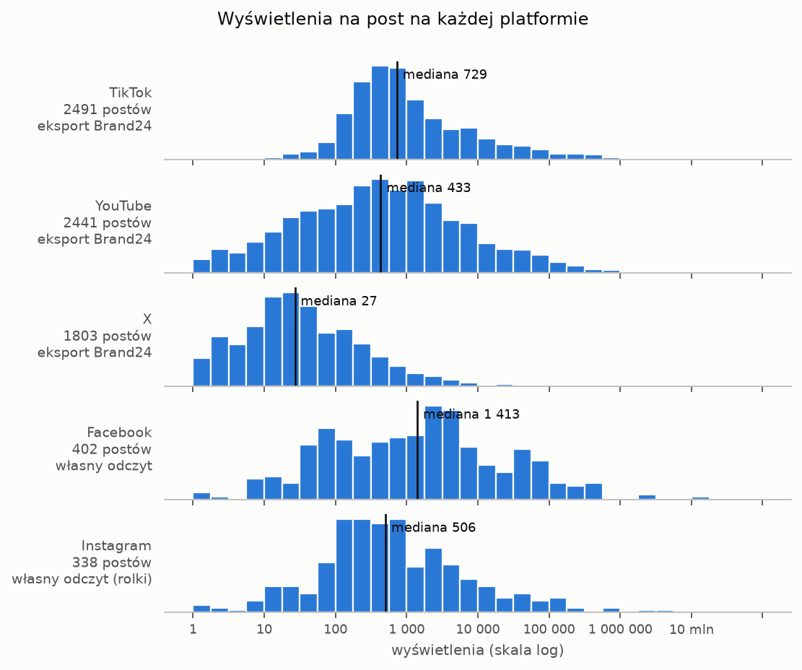

# Wstęp i dane: wersja robocza wygenerowana przez Claude (2026-11-08)

> Szkic do przepisania własnymi słowami. Wygenerowany przez AI na prośbę zespołu; użycie AI ujawnić w preprincie.
> Cytaty: Tatar, de Amorim, Fdida, Antoniadis 2014, *A survey on predicting the popularity of web content*, J. Internet Serv. Appl. 5:8 (metadane z Crossref);
> Shulman, Sharma, Cosley 2016, ICWSM, arXiv:1603.09436; Roy, Mei, Zeng, Li 2013, IEEE Trans. Multimedia (oba w `literature_notes.md`, checked).

## 1. Wstęp

Firmy monitorujące media, takie jak Brand24, raportują klientom, ile osób mogło zobaczyć wzmiankę o ich marce. Najprostsza
miara takiego zasięgu, liczba wyświetleń, często nie jest jednak widoczna: platformy ograniczają to, co pokazują
publicznie, a zakres tych danych zmienia się między platformami, formatami postów i w czasie. Bez niej trudno ocenić, ile
osób faktycznie zobaczyło dany post, a jeszcze trudniej przewidzieć, ile go zobaczy. W praktyce zasięg przybliża się więc
stałym mnożnikiem liczby obserwujących lub reakcji. Taki mnożnik nie mówi, jak bardzo może się mylić.

Przewidywanie popularności treści w sieci jest szeroko badane [Tatar i in. 2014]. Część prac sprawdza też przenoszenie
modeli między serwisami: Shulman i in. [2016] pokazują, że model uczony na jednym zbiorze (muzyka, książki, zdjęcia, linki)
działa podobnie dobrze na pozostałych, a Roy i in. [2013] przenoszą wiedzę z Twittera na popularność filmów na YouTube.
Prace te opierają się jednak na innych sygnałach (tempo pierwszych odbiorców, tematy) i oceniają model tam, gdzie wynik
jest znany. Nie znaleźliśmy pracy, która sprawdza oszacowanie wyświetleń z reakcji na platformach, gdzie wyświetlenia
są ukryte, wobec niezależnie zmierzonej prawdy; tam, gdzie wyświetleń nie widać, zwykle nie ma też z czym porównać.

W tej pracy pytamy, czy wyświetlenia posta na Facebooku i Instagramie da się oszacować z jego reakcji modelem uczonym
wyłącznie na innych platformach, i z jaką niepewnością. Korzystamy z 12 500 wzmianek o 348 markach z pięciu platform,
udostępnionych przez Brand24. Dla Facebooka i Instagrama sami zebraliśmy wyświetlenia razem z reakcjami odczytanymi w tym
samym momencie: 402 filmy z Facebooka i 338 rolek z Instagrama. Traktujemy je jako punkt odniesienia (ground truth). Wszystkie
modele oceniamy na markach, których nie widziały w treningu.

Nasz wkład jest następujący:
- Model uczony tylko na X i YouTube szacuje wyświetlenia na Facebooku z typowym błędem ×2,4, a na Instagramie ×2,65.
  Po kalibracji na 25 postach błąd na Instagramie spada do ×2,41, czyli prawie do poziomu modelu uczonego na samym
  Instagramie (×2,36).
- Prawie cały sygnał niosą reakcje. Tekst, etykiety treści, grafy autorów i marek oraz dane zewnętrzne o markach poprawiają
  błąd o najwyżej 0,01 w skali log10. Bez reakcji błąd rośnie do ×6–11.
- Dla każdego posta podajemy przedział niepewności (pokrycie przedziału 90%: 0,89–0,90), który pozostaje wiarygodny także
  wtedy, gdy części danych brakuje.
- Pokazujemy, jakie dane musi zbierać dostawca monitoringu, żeby takie oszacowanie działało. Najważniejsze jest odczytywanie
  reakcji w tym samym momencie co wyświetleń.

<!-- Do sprawdzenia przed oddaniem:
- liczby IG po partii 3 (rolki 501-950) mogą się zmienić;
- ×2,4 na FB = E93 (402 posty), ×2,65 / ×2,41 / ×2,36 IG = E202, pokrycie = E118, bez reakcji = E202 / E176, inne źródła <= 0,01 = E49, E100, E122, E170-E175;
- zakres: IG tylko rolki, FB tylko filmy; 20 marek FB, 11 marek IG (do ograniczeń). -->

## 2. Dane i pomiar

Korzystamy z 12 500 wzmianek o 348 markach, udostępnionych przez Brand24. Wzmianki pochodzą z pięciu platform (TikTok,
YouTube, X, Facebook, Instagram), 85% z nich opublikowano między kwietniem a sierpniem 2026, a 85% jest po angielsku.
Eksport zawiera liczbę wyświetleń dla prawie wszystkich wzmianek z TikToka (100%) i YouTube (99%) oraz dla 75% wzmianek
z X. Dla Facebooka i Instagrama eksport nie podaje wyświetleń, dlatego zebraliśmy je sami.

**Facebook.** Dla 130 filmów odczytaliśmy liczby ręcznie, a dla 402 pobraliśmy je automatycznie z publicznej strony
filmu, razem z reakcjami i komentarzami z tego samego odczytu. Facebook pokazuje dwie różne liczby: wyświetlenia
i odtworzenia, które różnią się od 2,3 do 3,6 raza (E95); używamy wyświetleń. Część linków już nie działa.

**Instagram.** Wylosowaliśmy 500 rolek z 11 marek, czyli z całego wycinka Instagrama w danych. Agent przeglądarki
na zalogowanym koncie członka zespołu odczytał dla każdej rolki wyświetlenia, polubienia i komentarze w jednym momencie,
tylko w trybie odczytu. Wyświetlenia udało się odczytać dla 368 rolek, a 132 zostały usunięte; przy 30 polubienia były
ukryte. Do modelu z polubieniami trafia więc 338 rolek. Zwykłe posty Instagrama (zdjęcia i karuzele) nie mają licznika
wyświetleń, więc wyniki dla Instagrama dotyczą tylko rolek.

**Odczyty z tego samego momentu.** Na Facebooku i Instagramie wyświetlenia i reakcje pochodzą z jednego odczytu.
W eksporcie Brand24 mogą pochodzić z różnych chwil. Dla TikToka, YouTube i X zebraliśmy więc dodatkowo własny odczyt
z jednego momentu i sprawdzamy, o ile zmienia on błąd na tych samych postach. Główne wyniki dla tych platform liczymy
jednak na danych z eksportu.

**Etykiety treści.** Typ i sentyment każdej wzmianki oznaczyły modele językowe (trzy niezależne kodery; zgodność kappa
0,77–0,79 dla typu i 0,71–0,73 dla sentymentu). Członek zespołu przejrzał ręcznie około 200 etykiet.

Tabela 1 i rysunek 1 podsumowują dane, na których oceniamy modele. Wyświetlenia na jeden post obejmują około siedmiu
rzędów wielkości, a typowy post na X ma ich kilkadziesiąt razy mniej niż na Facebooku. Mediana liczby wyświetleń
na jeden lajk różni się mniej: od 22 na X do 49 na Instagramie.

**Tabela 1.** Dane według platformy. Posty z wyświetleniami to te, które trafiają do modelu.

| Platforma | Wzmianki w eksporcie | Marki | Źródło wyświetleń | Posty z wyświetleniami (marki) | Mediana wyświetleń | Mediana lajków | Mediana wyświetleń na lajk |
|---|---|---|---|---|---|---|---|
| TikTok | 2 500 | 266 | eksport Brand24 | 2 491 (266) | 729 | 32 | 25 |
| YouTube | 2 500 | 273 | eksport Brand24 | 2 441 (273) | 433 | 6 | 26 |
| X | 2 500 | 273 | eksport Brand24 | 1 803 (252) | 27 | 0 | 22 |
| Facebook | 2 500 | 22 | własny odczyt | 402 (20) | 1 413 | 23 | 35 |
| Instagram | 2 500 | 11 | własny odczyt (rolki) | 338 (11) | 506 | 10 | 49 |

**Rysunek 1.** Rozkład wyświetleń na post na każdej platformie (skala logarytmiczna, pionowa kreska = mediana).
TikTok, YouTube i X: wyświetlenia z eksportu Brand24; Facebook i Instagram: nasz odczyt.

Wszystkie modele oceniamy na markach, których nie widziały w treningu (5-krotna walidacja krzyżowa z podziałem po
markach). Zasady zbierania danych, zgodność z regulaminami i RODO opisujemy w oświadczeniu o danych.

<!-- Do sprawdzenia: liczby IG po partii 3; akapit o odczytach z tego samego momentu dopiero gdy DeepSeek skończy odczyt
TT/YT/X (inaczej usunąć); kappa i odsetki z plan/preprint_plan.md sekcja 2; FB 130/402 = E93/E95; tabela 1 i rysunek 1 z `src/data_overview.py` (`data/processed/data_overview_numbers.json`), po partii 3 IG przeliczyć. -->
